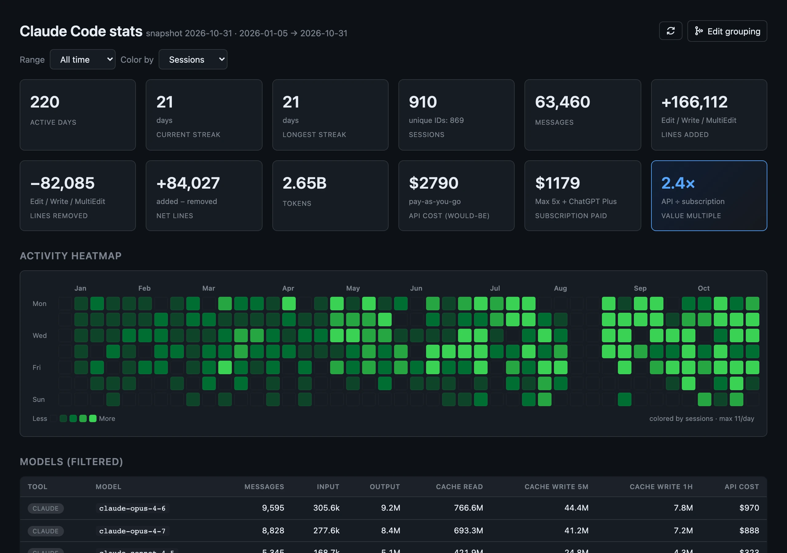
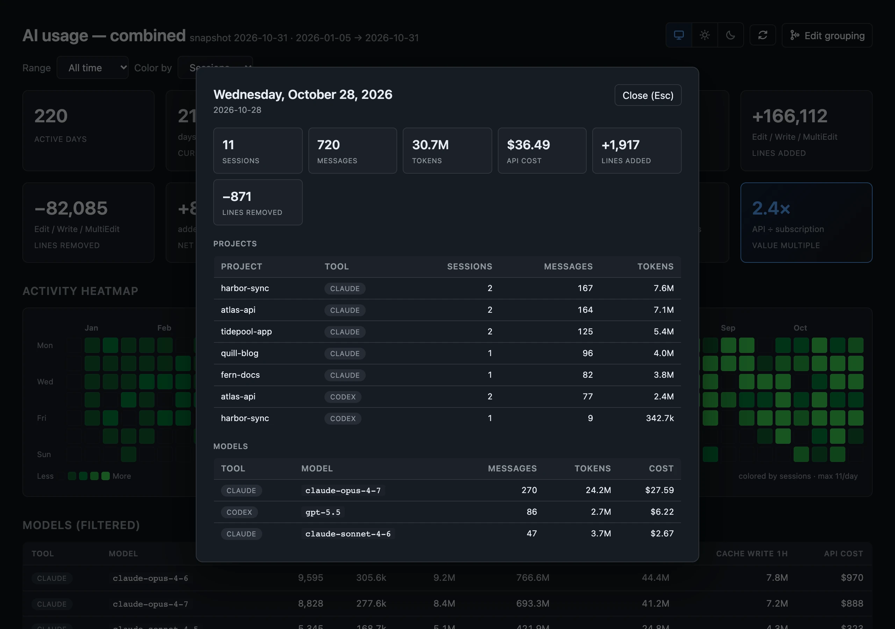
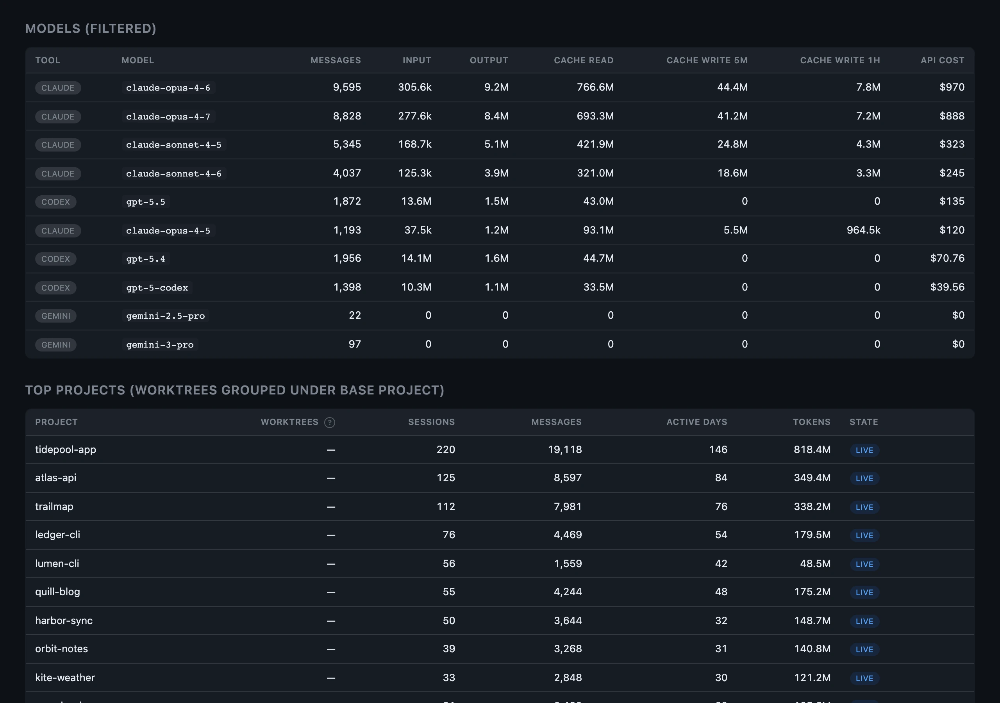

# vibestats

[](https://github.com/trebeljahr/vibestats/actions/workflows/ci.yml)
[](https://www.npmjs.com/package/@trebeljahr/vibestats)
[](LICENSE)

vibestats shows how you use Claude Code and Codex, day by day. It reads the transcripts these tools already keep on your disk and turns them into one dashboard.

You get a GitHub-style heatmap of your active days, plus tokens and cost for each day. You also see what your usage would cost at pay-as-you-go API prices. A value multiple sets that cost against what your subscription cost over the same months. vibestats also reads Gemini CLI, Goose, Cline, Roo Code and Kilo Code, plus claude.ai web chats if you fetch them.

Everything runs on your machine, with no account and no upload. Open the [demo with fictional data](https://vibestats.trebeljahr.com/demo/), or start with the [docs](https://vibestats.trebeljahr.com/docs/getting-started).

<picture>
  <source media="(prefers-color-scheme: light)" srcset="docs/marketing/screenshots/dashboard-overview-light.webp">
  <source media="(prefers-color-scheme: dark)" srcset="docs/marketing/screenshots/dashboard-overview.webp">
  
</picture>

<sub>All screenshots use fictional data from [`scripts/marketing/demo-history.mjs`](scripts/marketing/demo-history.mjs).</sub>

## Install

Pick whichever:

```bash
# npx (no install)
npx @trebeljahr/vibestats

# npm global
npm install -g @trebeljahr/vibestats
vibestats

# Homebrew (macOS, Linux)
brew tap trebeljahr/tap
brew install vibestats
vibestats

# Desktop app (DMG / MSI / AppImage)
# https://github.com/trebeljahr/vibestats/releases/latest
```

Or clone the repo for dev:

```bash
git clone https://github.com/trebeljahr/vibestats
cd vibestats
./install.sh                       # snapshot + build
./scripts/open.sh                  # open combined dashboard
# or  ./scripts/serve.sh           # localhost server
# or  pnpm tauri:dev               # desktop app dev mode
```

## What you get

- **Activity heatmap.** One square per day, colored by sessions, messages, tokens or API cost. Pick a range (month, 30 to 365 days, calendar year or all time) and step back through earlier windows with ‹ › or the arrow keys.
- **Per-day breakdown.** Click a day to see its sessions, messages, tokens, API cost and lines changed, split by project and by model.
- **Twelve stat cards** for the selected range: active days, current and longest streak, sessions, messages, lines added, removed and net, tokens, would-be API cost, subscription paid and the value multiple.
- **Models table** with messages, input, output, cache reads, 5-minute and 1-hour cache writes and API cost per model.
- **Top projects**, with sessions from git worktrees counted under their base project. Archived Claude Code projects are marked.
- **Project merging.** `project-aliases.json` joins renamed projects, and `vibestats merges` lists likely renames for you to accept or reject.
- **Shareable copies.** `vibestats redact` writes dashboards with hashed project names. See [Sharing a dashboard](#sharing-a-dashboard).
- **Light and dark themes.** The dashboard follows your system setting. A toggle in the header pins light or dark.
- **Desktop app** for macOS, Windows and Linux, with a settings panel for your plan and prices.

<picture>
  <source media="(prefers-color-scheme: light)" srcset="docs/marketing/screenshots/day-breakdown-light.webp">
  <source media="(prefers-color-scheme: dark)" srcset="docs/marketing/screenshots/day-breakdown.webp">
  
</picture>

<picture>
  <source media="(prefers-color-scheme: light)" srcset="docs/marketing/screenshots/models-and-projects-light.webp">
  <source media="(prefers-color-scheme: dark)" srcset="docs/marketing/screenshots/models-and-projects.webp">
  
</picture>

## Privacy

vibestats runs locally. It makes no network calls except `vibestats fetch-web` and `vibestats prices update`, and both run only when you start them. There is no telemetry, no update check and no analytics. Snapshots, dashboards and configs live in `~/.vibestats/` with 0700/0600 permissions.

vibestats reads full Claude Code and Codex transcripts. Those files hold everything you typed into the tools, including secrets you pasted (API keys, `.env` files, customer data). The generated dashboards contain raw project names and timestamps. Do **not** commit `~/.vibestats/snapshots/` to git. Do not post a dashboard on the public internet without running `vibestats redact` first. See [Keep personal history local](#keep-personal-history-local) and [PRIVACY.md](PRIVACY.md).

## What it reads

- `~/.claude/projects/` + `~/.claude/projects-archive/` — Claude Code transcripts. Archive is included because the CLI auto-archives older project dirs and the built-in `/stats` widget can't see them.
- `~/.codex/archived_sessions/` — Codex rollout jsonl. The 3GB `logs_2.sqlite` debug log is skipped on purpose.
- `~/.gemini/tmp/` + `~/.gemini/history/` — Gemini CLI sessions. Gemini CLI stores no token counts locally, so these count sessions, messages and active days, at $0.
- Goose `sessions.db` — from `$GOOSE_PATH_ROOT`, `~/Library/Application Support/Block/goose/sessions/` or `~/.local/share/goose/sessions/`. Needs Node 22 or later (`node:sqlite`).
- Cline, Roo Code and Kilo Code task folders in VS Code and Cursor `globalStorage`, on macOS and Linux.
- claude.ai web chats, only after you fetch them. See [Optional: claude.ai web chats](#optional-claudeai-web-chats).
- `~/.gemini/antigravity/conversations/` — Gemini Antigravity protobuf (snapshotted for safekeeping; parser not yet written).

Missing dirs are silently skipped, so this works whether you use one tool or all of them.

## What it computes

- **Active days, current/longest streak, sessions, messages, tokens** — per filtered range
- **API cost (would-be)** — what your usage would have cost at pay-as-you-go rates
- **Subscription paid** — prorated from your subscription start date through the last active day in the range
- **Value multiple** — API cost ÷ subscription paid

## Navigating time

The **Range** control picks a window size (month, 30/90/180/365 days, calendar year, or all time); the **‹ ›** pager next to it steps that window backwards and forwards, one whole window at a time. Left/right arrow keys do the same.

Paging past your first day of data is allowed on purpose — an empty year is a real answer to "was I using this back then?". Every window draws its full span, so an empty stretch shows as an empty grid rather than a missing chart, and the stats read zero rather than falling back to totals.

## Config

Two files seeded from `*.example.json` on first run:

- **`pricing.json`** — model prices per million tokens (Anthropic + OpenAI), plus your subscription tier, monthly cost, and start date. Edit these to match reality.
- **`project-aliases.json`** — merge renamed/duplicate projects into one canonical row. Add entries when you rename a project mid-development so its old and new dirs show up as one.

### Keeping prices fresh

The Claude/OpenAI model lineup churns. Rather than chasing every price tweak by hand, you can pull the latest rates from [LiteLLM's model_prices_and_context_window.json](https://github.com/BerriAI/litellm/blob/main/model_prices_and_context_window.json) — a daily-updated, community-maintained price table covering ~2700 models:

```bash
vibestats prices update    # fetch + cache LiteLLM pricing
vibestats prices show      # list cached rates for models you've actually used
```

What this does:

- Fetches the LiteLLM JSON over HTTPS (one GET; no auth needed).
- Filters down to the Claude (`anthropic` provider, `claude-*` names) and OpenAI (`openai` provider, `gpt-*` / `o*` names) families vibestats actually meters — currently ~21 Claude + ~84 OpenAI models — and converts per-token prices to the `$/MTok` shape `pricing.json` uses.
- Writes the result to `pricing-cache.json` in your data dir, at `0600` perms. Safety: refuses to write if the response has fewer than 100 entries (guards against a truncated download).
- Builders merge `pricing-cache.json` on top of `pricing.json` if the cache is **less than 30 days old**. Older than that, the cache is ignored and you see a "re-run `vibestats prices update`" hint at build time. **Your subscription block in `pricing.json` is never touched** — only per-model rates are layered in.

This is opt-in: vibestats does **not** auto-fetch. It only hits the network when you explicitly run `vibestats prices update` (or `vibestats fetch-web` for claude.ai chats). Everything else is local-only.

## Optional: claude.ai web chats

The web chat history isn't on disk locally (Claude Desktop is a web wrapper). To include those chats:

```bash
# 1. Open claude.ai logged in
# 2. DevTools → Application → Cookies → claude.ai → copy the sessionKey value
export CLAUDE_SESSION_KEY=sk-ant-sid01-...
# or write to ~/.claude-stats-config.json:  { "session_key": "sk-ant-sid01-..." }

node scripts/fetch-claude-web.js          # downloads conversations to snapshots/<date>/claude-web/
./scripts/build-all.sh                    # rebuilds with web chats included
```

Caveat: the web API doesn't return per-message token counts. Web-chat cost is estimated from message count × heuristic (1200 input + 600 output tokens per message). Tweak the constants in `build-claude-web-dashboard.js` if your conversation style is different.

## Output files

All written to your data dir (`~/.vibestats/` by default):

- `dashboard.html` — Claude Code only
- `codex-dashboard.html` — Codex only
- `gemini-dashboard.html`, `goose-dashboard.html`, `cline-dashboard.html` — one per tool, when that tool's data exists
- `claude-web-dashboard.html` — claude.ai web chats only (if fetched)
- `combined-dashboard.html` — all of the above merged. The app and `vibestats open` show this one.

Each is a standalone HTML file with its data inlined as JSON. Open it in a browser. There is no backend.

## Sharing a dashboard

The dashboards contain your raw usage metadata: project names, timestamps and token counts. To share one, make a redacted copy first:

```bash
vibestats redact                          # write redacted-*.html with hashed project names
vibestats redact --coarsen-dates=week     # also bucket the heatmap by week (or =month)
vibestats redact --check                  # scan the latest snapshot for secret patterns
```

Redacted files still show usage totals, costs and model names. Review each file before you share it. Copy only the reviewed HTML files into a new, empty directory before you upload them. Never deploy the repository or the data dir. The [sharing guide](https://vibestats.trebeljahr.com/docs/deploying-and-sharing) has the details.

## Known gaps

- Gemini Antigravity conversations are protobuf without a bundled `.proto` definition. Files captured for future parsing.
- Gemini CLI logs no token counts, so Gemini rows show $0.
- Server-tool charges (web search at $10/1k, code execution runtime) are excluded — not exposed cleanly in the jsonl.
- Claude fast-mode (6× premium on Opus 4.6/4.7) isn't detectable from jsonl. Real Claude cost is likely higher than reported.

## Refresh

Dashboards are static HTML built from a point-in-time read of your transcripts. Nothing re-reads your data while a dashboard is open, so the header always states what the page was built from and flags it once it is more than a day old.

Two ways to rebuild:

```bash
vibestats live                            # read ~/.claude, ~/.codex, ~/.gemini in place, rebuild, open
vibestats all                             # snapshot (rsync, ~2GB) + rebuild + open
```

`live` is the fast path — seconds, no copy — and is what you want when the dashboard looks out of date. `all` additionally archives a dated snapshot, which is what preserves history and what `redact` operates on.

Piecewise:

```bash
./scripts/snapshot.sh                     # rsync ~/.claude, ~/.codex, ~/.gemini into snapshots/<today>/
./scripts/build-all.sh                    # rebuild HTMLs from latest snapshot
VIBESTATS_LIVE=1 ./scripts/build-all.sh   # rebuild HTMLs straight from the live dirs
```

Snapshots are dated dirs; nothing is destructive. Keep them out of git: they hold full transcripts.

`vibestats fetch-web` (claude.ai chats) writes into the newest snapshot, so that one tool is snapshot-only — in live mode its data comes from the last snapshot taken.

### Dev preview

`pnpm dev` serves the dashboard from your **live** data (the dev server runs the live build on startup; the Refresh button re-runs it). Set `VIBESTATS_FIXTURE=1` to use the checked-in fictional `dev/dashboard-preview/sample-payload.json` instead — useful for working on the UI with no local history.

`pnpm marketing:capture` rebuilds the README screenshots and the social preview cards in [`docs/marketing/`](docs/marketing/) from a generated fictional history. It never reads your own tool dirs. It needs Playwright with Chromium (see [docs/marketing/README.md](docs/marketing/README.md)).

`pnpm demo:build` rebuilds the public demo, `site/public/demo/index.html`, from the same fictional history. It needs no browser.

## Keep personal history local

New installations use `~/.vibestats`; `VIBESTATS_DATA_DIR` selects another private directory. Existing clones with `pricing.json` keep their data in place. Source discovery uses the current user's home directory. Missing tool installations are skipped during snapshots. Snapshot refreshes preserve files that disappeared from the source.

Run `pnpm privacy:check` before committing or packaging source. This checks tracked file paths and selected private-path patterns; it is not a complete secret scanner. Generated state, including `pending-merges.json`, must remain ignored. Never force-add usage files or push old branches containing them.

Public demos use fictional data. Redacted dashboards still contain activity and cost information: review each file before sharing. Never deploy the repository or data directory as a website.

For a source clone, enable the push guard with `git config core.hooksPath .githooks`. It checks the history being pushed for known private paths. Keep any pre-existing history containing personal data private; do not merge it into a clean public repository.

## Project layout

- `bin/cli.js` — the `vibestats` command
- `scripts/` — snapshot, one builder per tool, the dashboard template, `redact`, `prices`, `merges`
- `src-tauri/` — the desktop app
- `site/` — [vibestats.trebeljahr.com](https://vibestats.trebeljahr.com): landing page, docs and the fictional demo
- `fixtures/` — synthetic snapshots for CI
- `docs/marketing/` — screenshots and social preview cards, all from fictional data

Built with Node.js 18+ and no runtime dependencies. The dashboards are one HTML template with inline JavaScript. The desktop app uses Tauri 2. The site uses Next.js and Fumadocs.

## Contributing

Bug reports, parser requests for other tools and pull requests are welcome. See [CONTRIBUTING.md](CONTRIBUTING.md). Report security issues privately as described in [SECURITY.md](SECURITY.md).

## License

MIT. See [LICENSE](LICENSE).

## Support

vibestats is free. If you want to support its development, you can do so at [ricos.site/donate](https://ricos.site/donate).
